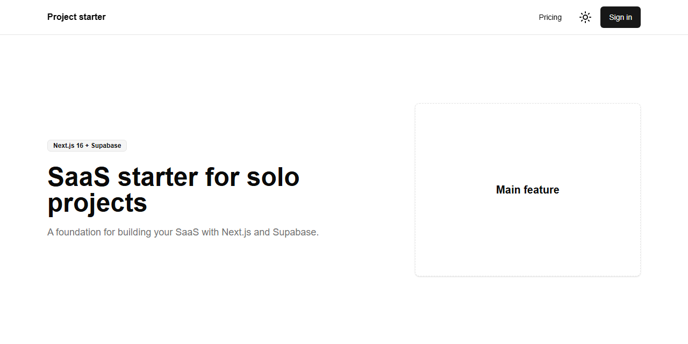
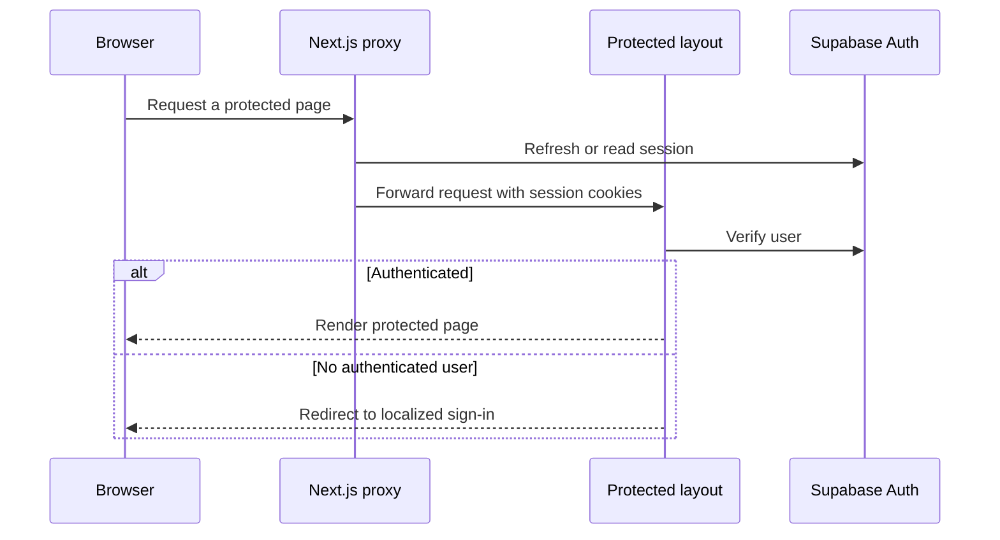

# next-supabase-user-solo-saas-starter

A Next.js starter for SaaS products with one account per user, backed by Supabase Auth and Postgres.

[](../../actions/workflows/ci.yml)
[](../../releases/latest)
[](LICENSE)

[**Live Demo**](https://next-supabase-user-solo-saas-starte.vercel.app)

[](https://vercel.com/new/clone?repository-url=https%3A%2F%2Fgithub.com%2FMarkupChef%2Fnext-supabase-user-solo-saas-starter)



## Features and stack

- Email/password registration and sign-in, password reset, Google OAuth, and sign-out.
- Protected profile, settings, plan, and billing pages. Account deletion is available when configured.
- English and Ukrainian routes and messages via next-intl, with light, dark, and system themes.
- Next.js App Router, React, TypeScript, Tailwind CSS, and local shadcn-style components.
- Supabase Auth and Postgres with user-scoped row-level security, React Hook Form with Zod, and TanStack Query.
- Vitest, React Testing Library, and Playwright.

## Limitations

The plan and billing pages are placeholders. Payment processing and Stripe integration are out of scope. Supabase configuration is required to exercise the authenticated flows.

## Quick start

Install Node.js 24 and Corepack. If Corepack is missing, run `npm install --global corepack@0.35.0`.

From the project root, install dependencies.

```sh
corepack pnpm install --frozen-lockfile
```

If you want to connect Supabase, copy `.env.example` to `.env.local` and replace the placeholders first. Use `cp .env.example .env.local` on macOS/Linux or `Copy-Item .env.example .env.local` in PowerShell. Leave `.env.local` absent to preview the public pages without Supabase.

```sh
corepack pnpm dev
```

Open [http://localhost:3000](http://localhost:3000). Protected pages redirect to sign-in until an authenticated session is available.

## Connect a cloud Supabase project

1. Create a new project in the [Supabase Dashboard](https://supabase.com/dashboard). Copy the project URL and publishable key into `.env.local`.
2. Apply the [baseline migration](supabase/migrations/20260513143000_initial_saas_scaffold.sql) using one method. With the [Supabase CLI](https://supabase.com/docs/guides/local-development/database-migrations), run these commands from the repo root. If the project will be managed manually, open SQL Editor in the Dashboard and run the contents of the migration file once.

   ```sh
   supabase init
   supabase login
   supabase link --project-ref YOUR_PROJECT_REF
   supabase db push
   ```

3. In Authentication → URL Configuration, set **Site URL** to the public app origin. Use `http://localhost:3000` for a local-only setup. Add the following **Redirect URLs** for each environment you use. They cover email confirmation, password recovery, and Google OAuth. Replace the production example origin with yours. [Supabase redirect URL documentation](https://supabase.com/docs/guides/auth/redirect-urls)

   | Local | Production |
   | --- | --- |
   | `http://localhost:3000/auth/callback?next=/` | `https://app.example.com/auth/callback?next=/` |
   | `http://localhost:3000/auth/callback?next=/reset-password` | `https://app.example.com/auth/callback?next=/reset-password` |
   | `http://localhost:3000/uk/auth/callback?next=/uk` | `https://app.example.com/uk/auth/callback?next=/uk` |
   | `http://localhost:3000/uk/auth/callback?next=/uk/reset-password` | `https://app.example.com/uk/auth/callback?next=/uk/reset-password` |

4. For Google OAuth, create a **Web application** OAuth client in Google Cloud. Add your app origins under **Authorized JavaScript origins**. Set the authorized redirect URI to the Supabase callback shown in the Google provider settings, typically `https://YOUR_PROJECT_REF.supabase.co/auth/v1/callback`. Enable Google in Supabase Authentication → Sign In / Providers and save the Google client ID and secret there. [Supabase Google setup](https://supabase.com/docs/guides/auth/social-sign-in/auth-google)

5. Restart the dev server after updating `.env.local`. Set the production app origin and Supabase values in the hosting environment before building for deployment.

### Environment variables

| Variable | Purpose |
| --- | --- |
| `NEXT_PUBLIC_SUPABASE_URL` | Cloud Supabase project URL. Required for Auth. |
| `NEXT_PUBLIC_SUPABASE_PUBLISHABLE_KEY` | Supabase publishable key. Required for Auth. |
| `NEXT_PUBLIC_APP_URL` | App origin for auth callbacks. Defaults to `http://localhost:3000`. |
| `SUPABASE_SERVICE_ROLE_KEY` | Optional server-only service role key for [account deletion](app/api/account/route.ts). Leave empty to disable deletion. |

### Deploy to Vercel

Use the deploy button above, then configure the Vercel environment variables and Supabase redirect URLs. Set `NEXT_PUBLIC_APP_URL` to the assigned deployment origin and redeploy after saving it. The public pages can run without Supabase. Use a dedicated Supabase project for testing registration and sign-in.

#### Supabase keep-alive for the demo

Three daily Vercel cron jobs make one read-only Supabase Data API request each, during the 01:00, 09:00, and 17:00 UTC hours. They run on Production deployments, including Hobby. Add a random `CRON_SECRET` to the Production environment before deploying this version. Generate one with `node -p "require('node:crypto').randomBytes(32).toString('hex')"`. The jobs use the existing Supabase publishable key and require the baseline migration.

After deploying, check the jobs in Vercel under **Schedules → Cron Jobs**. A successful request returns `204`. A Supabase or configuration failure returns `503`. Supabase Free can still pause projects with low database activity. If the project is already paused, resume it in the Supabase Dashboard.

## Project structure

| Path | Responsibility |
| --- | --- |
| `app/` | Next.js App Router. `[locale]/(auth)` contains public auth routes, `[locale]/(app)` contains protected pages, and `api/account` handles account deletion. |
| `src/app/` | Providers, global styles, and the protected app shell. |
| `src/views/` | Page-level composition. |
| `src/widgets/` | Reusable UI blocks such as navigation. |
| `src/features/` | User flows such as authentication, account deletion, and language switching. |
| `src/entities/` | Domain types, schemas, and data access. |
| `src/shared/` | UI primitives, Supabase clients, config, i18n, and utilities. |
| `supabase/migrations/` | Baseline schema for profiles and billing. |

## Key decisions

- **User-scoped tenancy.** Profiles and billing records belong to individual users. [The baseline migration](supabase/migrations/20260513143000_initial_saas_scaffold.sql) scopes access with Postgres row-level security.
- **Server-side auth.** [The request proxy](proxy.ts) refreshes the Supabase session and [the protected layout](app/%5Blocale%5D/%28app%29/layout.tsx) verifies it before rendering private pages.
- **Locale-aware routing.** [The routing configuration](src/shared/i18n/routing.ts) gives English unprefixed URLs and Ukrainian a `/uk` prefix.
- **Thin route files.** [Feature-Sliced Design](https://feature-sliced.design/) keeps page composition in views and shared code in lower layers.



## Recommended AI tooling

These tools are optional. Install what fits your coding agent and the part of the stack you work on.

### Configure agent instructions

If your project has no `AGENTS.md` yet, rename [AGENTS.example.md](AGENTS.example.md) to `AGENTS.md` and add your project-specific requirements. If you already have an `AGENTS.md`, add those requirements directly to that file.

### Agent skills

| Skill | Use it for | Install from the project root |
| --- | --- | --- |
| [shadcn/ui](https://ui.shadcn.com/docs/skills) | Working with the local UI primitives, aliases, and theme configured in `components.json`. | `npx skills add shadcn/ui` |
| [Supabase and Supabase Postgres Best Practices](https://supabase.com/docs/guides/ai-tools/ai-skills) | Auth, SSR sessions, schema migrations, and row-level security. | `npx skills add supabase/agent-skills` |
| [Vercel React Best Practices](https://github.com/vercel-labs/agent-skills/blob/main/skills/react-best-practices/SKILL.md) | React component design, data fetching, and performance reviews. | `npx skills add vercel-labs/agent-skills --skill vercel-react-best-practices` |
| [Feature-Sliced Design](https://fsd.how/docs/llms/) | Choosing layers, organizing slices, and defining public APIs within the conventions in [AGENTS.example.md](AGENTS.example.md). | `npx skills add https://github.com/feature-sliced/skills --skill feature-sliced-design` |

For Next.js work, read the framework documentation bundled in `node_modules/next/dist/docs/`. [Next.js agent guidance](https://github.com/vercel-labs/next-skills)

### MCP servers

| Server | Use it for | Setup |
| --- | --- | --- |
| shadcn MCP | Finding components, blocks, and installation instructions in shadcn registries. | [shadcn MCP setup](https://ui.shadcn.com/docs/mcp) |
| Next.js DevTools MCP | Inspecting routes and runtime errors while `corepack pnpm dev` is running. | [Next.js MCP setup](https://nextjs.org/docs/app/guides/mcp) |
| Playwright MCP | Checking pages and user flows interactively in a browser. Run `corepack pnpm test:e2e` for the repository's automated smoke tests. | [Playwright MCP setup](https://github.com/microsoft/playwright-mcp) |
| Supabase MCP | Inspecting schema, migrations, and logs in a test project. | [Supabase MCP setup](https://supabase.com/docs/guides/ai-tools/mcp) |

For Supabase MCP, replace `YOUR_TEST_PROJECT_REF` with your test project's reference and use this read-only server URL in your MCP client.

```text
https://mcp.supabase.com/mcp?project_ref=YOUR_TEST_PROJECT_REF&read_only=true&features=docs,database,debugging
```

### Plugin

The Supabase Plugin bundles the Supabase MCP server and both Supabase skills. Install it with `npx plugins add supabase-community/supabase-plugin` if you prefer one setup, then apply the same test project scope and read-only settings to its MCP connection. [Supabase Plugin setup](https://supabase.com/docs/guides/ai-tools/plugins)

## Add or remove a locale

1. Update the locale list and labels in [routing.ts](src/shared/i18n/routing.ts). If removing the default locale, select a new default. The default locale has no URL prefix.
2. Add or remove the corresponding catalog in [messages](src/shared/i18n/messages). Keep the same message keys across catalogs. If removing English, move the shared `Messages` type to a remaining catalog and update its consumers.
3. Update locale-specific tests and Supabase callback URLs. Each non-default locale uses `/<locale>/auth/callback`.

See the [routing configuration](src/shared/i18n/routing.ts) and [browser smoke tests](tests/e2e/app.spec.ts) for examples.

## Scripts

Run scripts with `corepack pnpm <script>`.

| Script | Purpose |
| --- | --- |
| `dev` | Start the development server. |
| `build` | Build for production. |
| `start` | Serve the production build. |
| `typecheck` | Run TypeScript checks. |
| `lint` | Run ESLint. |
| `test` | Run Vitest in watch mode. |
| `test:run` | Run unit and component tests once. |
| `test:e2e` | Build and serve the app on port 3100, then run Playwright smoke tests. |

Install the test browser once with `corepack pnpm exec playwright install chromium`. On Linux, use `corepack pnpm exec playwright install --with-deps chromium` if system browser dependencies are missing. Run `corepack pnpm test:e2e` without local Supabase credentials for the same unconfigured app used by the smoke tests. CI runs typecheck, lint, unit tests, and build without Supabase credentials.

## Contributing

The project owner develops and maintains this project. Bug reports are welcome via [GitHub Issues](../../issues). External pull requests are currently not accepted. See [Contributing](CONTRIBUTING.md) for bug report details.

## License

[MIT](LICENSE).
